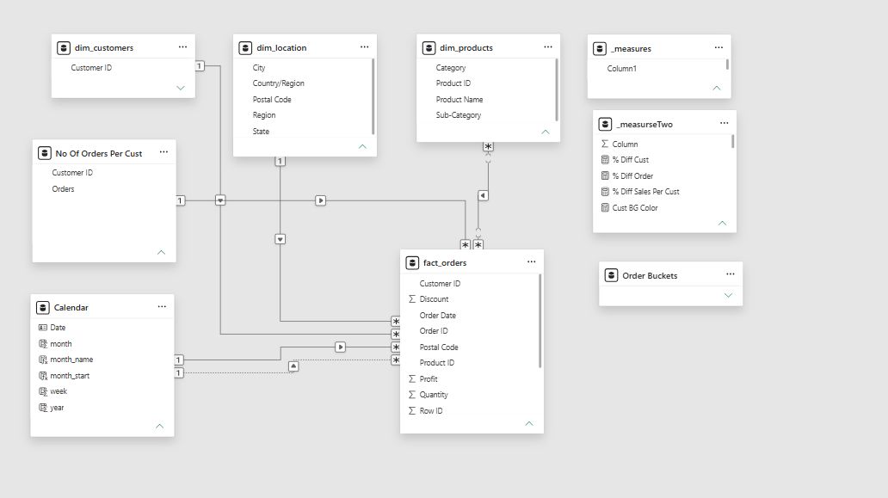
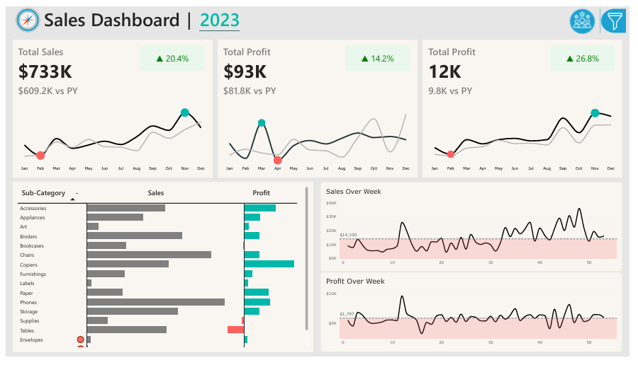
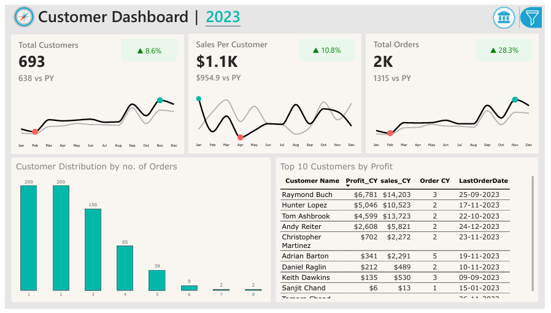

# Sales Performance Dashboard - Power BI

### Project Overview
This project analyzes sales performance, customer behavior, and product trends using Power BI. The dashboard provides actionable insights for business stakeholders through interactive visualizations and KPI tracking.

### Business Objectives
- Monitor overall sales performance
- Identify top-performing products
- Analyze customer segments
- Track regional sales trends
- Measure profitability and growth

### Dashboard Features
- Executive Summary View
- Sales Trend Analysis
- Product Performance Analysis
- Customer Insights
- Interactive Filters and Drill-throughs

### Tools Used 
Power BI Desktop | DAX | Power Query | Excel / CSV | Data Modeling

### Key KPIs
- Total Revenue
- Total Orders
- Profit Margin
- Customer Count
- Sales Growth %
### Data Model

### Sales Dashboard

### Customer Dashboard

### Insights Generated
### Author
